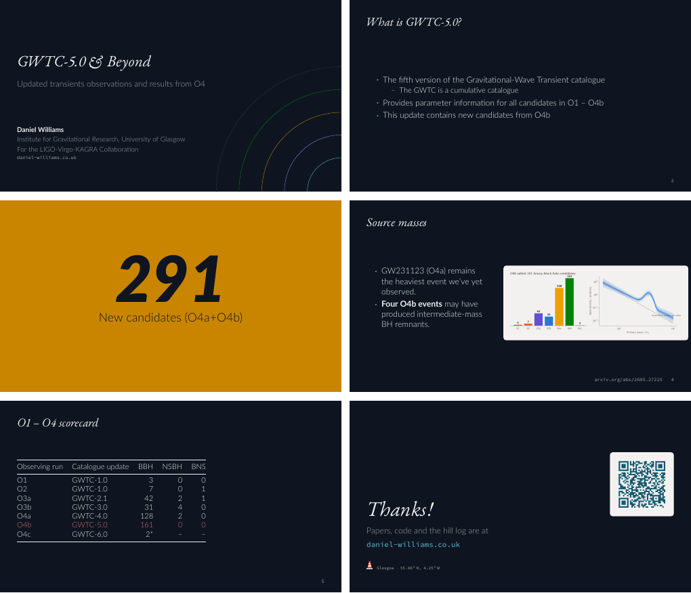

# Beamer theme

`beamerthemekentigern.sty` implements the slide guide (`design-system/slides.md`) for LaTeX Beamer: dark ground by default, serif italic titles, Lato Light body, Source Code Pro for references, flat blocks, a ripple-arc title slide and one loud stat slide. All colours come from `kentigern-tokens.sty` (generated from `tokens/tokens.json`).



## Use

```latex
\documentclass[aspectratio=169,11pt]{beamer}
\usetheme{kentigern}            % or \usetheme[light]{kentigern} for Parchment
```

Build the example from the repository root: `make beamer`. Without `make`, put `latex/beamer` and `tokens/dist` on `TEXINPUTS`:

```
TEXINPUTS=.:../../tokens/dist//: xelatex example.tex
```

## Commands

| Command | What it does |
|---|---|
| `\titlepage` | Title slide: serif italic title, subtitle in `ink-muted`, author, institute, the site address and ripple arcs bottom-right. Set the address with `\kentigernurl{...}`. |
| `\kentigernstat[gold\|red\|blue]{291}{label}` | Full-bleed big-number frame with the matching `on-*` text colour. |
| `\kentigernref{arxiv.org/abs/...}` | Puts a citation in the footer, left of the slide number, for the current frame only. |
| `\kentigernpanel{\includegraphics{fig.png}}` | A published figure on a light `panel` tile. |
| `\kentigernthanks[qr.png]{daniel-williams.co.uk}` | Closing frame with an optional QR image, plus the Glasgow footer (`\kentigerngeo`). |
| `\alert{...}` | Highland Rust emphasis. |

Blocks are flat, bullets are small teal dots, and there are no navigation symbols or headline.

## Fonts and engines

Use **XeLaTeX** or **LuaLaTeX**; the theme loads EB Garamond, Lato (Light, Bold, Black) and Source Code Pro by name through `fontspec`, so they must be installed on the system. pdfLaTeX compiles but uses the default Latin Modern fonts.

Tested: TeX Live 2023 with XeLaTeX, LuaLaTeX and pdfLaTeX, dark and light.
